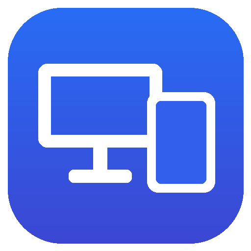

<h1 align="center">GetSide</h1>

<b>Turn your Android tablet into a real second monitor for Windows.</b> 
USB without developer mode · Wi-Fi · touch · PC audio · up to 60 fps

  <a href="https://getsidescreen.com"><b>Website</b></a> ·
  <a href="https://github.com/mangoboom178/sidescreen-site/releases/latest/download/GetSide-Setup.exe">Download for Windows</a> ·
  <a href="https://getsidescreen.com/apk">Android app (APK)</a>

---

## What it does

GetSide adds a virtual monitor to Windows and streams it to an Android tablet or phone. Windows treats the tablet as a normal display — its own resolution, placed left or right in **Settings → Display** — so you can drag Discord, OBS, documents or Task Manager onto it.

- **USB without developer mode** — uses the tablet's built-in *USB tethering* switch. No ADB, no USB debugging.
- **Wi-Fi** — or just put the PC and tablet on the same network.
- **Hardware encoding** on NVIDIA, AMD and Intel GPUs, up to 60 fps, up to the tablet's native resolution.
- **Touch as a Windows touchscreen** (multi-touch) or mouse mode.
- **PC audio on the tablet** — tablet only, PC only, or both.
- **Pen with pressure and tilt** (beta).
- **Game guard** — the cursor stays on the main screen while a full-screen game is active.
- No account. Picture and input travel only between your PC and your tablet.
- 10 languages.

## Requirements

| | |
|---|---|
| PC | Windows 10 / 11, 64-bit |
| Tablet / phone | Android 7.0 or newer |

## Get started

1. Install **GetSide** on the PC and the **GetSide** app on the tablet.
2. Connect a USB cable and turn on *USB tethering* on the tablet — or use the same Wi-Fi.
3. Done: Windows now has a second monitor.

## Pricing

7-day free trial with every feature, no card required. Then **Standard** — $10.99 / 3 months or $29.99 lifetime, or **Maximum** (audio, pen, mirroring, mouse mode, game guard) — $14.99 / 3 months or $49.99 lifetime. The Android app is free. Details at [getsidescreen.com](https://getsidescreen.com/#pricing).

## Support

support@getsidescreen.com

---

This repository hosts the download page and releases only. Source code is closed.
